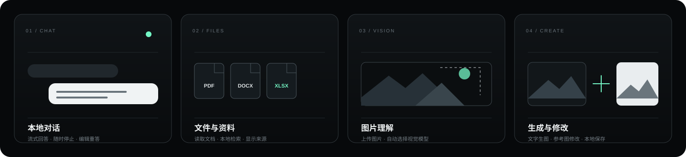

<p align="center">
  
</p>

<h1 align="center">🛰️ ShotAI · 局域网本地 AI 工作台</h1>

<p align="center">
  <strong>一台主机运行模型，其他电脑打开浏览器即可使用。</strong>
</p>

<p align="center">
  
  
  
  
  
  
  
  
  
  
</p>

<p align="center">
  <a href="https://github.com/ReDChicagOTypewriteR/ShotAI"></a>
  <a href="https://github.com/ReDChicagOTypewriteR/ShotAI/issues"></a>
  <a href="https://github.com/ReDChicagOTypewriteR/ShotAI/stargazers"></a>
  <a href="CHANGELOG.md"></a>
  <a href="docs/README.md"></a>
</p>

<br />

<p align="center">
  <a href="http://alexjoker.top/projects/ShotAI/">
    
  </a>
</p>

<p align="center">
  <a href="http://alexjoker.top/projects/ShotAI/">产品介绍</a> ·
  <a href="https://github.com/ReDChicagOTypewriteR/ShotAI/releases/tag/v1.2.0">1.2.0 下载</a> ·
  <a href="docs/USER_GUIDE.md">使用指南</a> ·
  <a href="docs/LAN_DEPLOYMENT.md">内网部署</a> ·
  <a href="docs/README.md">全部文档</a>
</p>

<br />

<p align="center"><sub>THE WORKBENCH / 工作台</sub></p>


<p align="center"><sub>统一的对话、文件、模型与图片创作入口</sub></p>

<p><sub>01 / RELEASE HIGHLIGHTS</sub></p>

## 1.2.0 · 大模型导入、五人并发与对话式图片创作

| 一次读取大模型 | 五人容量保护 | Windows / Ubuntu 独立交付 |
| --- | --- | --- |
| GGUF 先快速检查，正式导入时边写入边计算 SHA-256，避免十几 GB 文件提前完整扫描 | 默认两路推理、三路等待，第六路明确限流；主机监控显示运行数和排队数 | 公共核心保持一致，Windows EXE 与 Ubuntu DEB 分别使用自己的运行组件、路径和发布目录 |

对话输入现在会自动识别“帮我生成一张图片”和“把上面的图片再优化”等请求。
当前服务器聊天模型基线明确为 Qwen3.5。完整更新见
[1.2.0 总说明](docs/RELEASE_1.2.0.md)、[Ubuntu 说明](docs/UBUNTU_1.2.0.md)和
[Windows 说明](docs/WINDOWS_1.2.0.md)。

<p><sub>02 / OVERVIEW</sub></p>

## 一台主机，所有人直接使用

ShotAI 把本地模型、文件、资料库和图片能力放进同一个网页。管理员只需在主机准备运行组件和模型，局域网内的其他电脑打开浏览器即可使用，无需分别安装 Node.js、Ollama 或模型。


<p><sub>03 / CAPABILITIES</sub></p>

## 已经可以做什么



| 能力 | 使用体验 | 当前支持 |
| --- | --- | --- |
| AI 对话 | 流式回答，可停止、重答、继续和编辑问题 | 本地 Ollama 模型 |
| 文件阅读 | 添加文件后直接提问 | TXT、Markdown、PDF、DOCX、Excel |
| 图片理解 | 上传图片并让模型分析 | PNG、JPEG、WebP 与视觉模型 |
| 本地资料库 | 从导入资料中查找答案并显示来源 | Embedding 或关键词检索 |
| 图片创作 | 在对话框内生成图片、参考图修改 | 本地图片模型与运行组件 |
| 模型管理 | 一个入口完成识别、导入、查看和清理 | GGUF、mmproj 与图片配套文件 |
| 主机监控 | 查看在线数量、隐藏 IP 和主机性能 | 仅限主机、管理员登录、实时轻量图表 |
| 内网共享 | 主机运行，其他电脑用浏览器访问 | Windows / Ubuntu Electron 与 9090 服务 |

<p><sub>04 / GET STARTED</sub></p>

## 三步开始

### Windows / Ubuntu 使用者

1. 安装并启动 ShotAI；
2. 在“模型管理”中添加已经下载好的模型；
3. 将界面显示的 `http://主机IP:9090` 发给局域网使用者。

模型不会随源码仓库提供。第一次部署请先阅读 [使用指南](docs/USER_GUIDE.md) 和 [内网部署说明](docs/LAN_DEPLOYMENT.md)。

### Ubuntu 22.04 完整离线版

| 文件 | 推荐场景 |
| --- | --- |
| `ShotAI-1.2.0-Ubuntu-22.04-x86_64-Full-Ollama-CUDA.deb` | Ubuntu 22.04 x86_64 完整离线运行环境 |

安装包可从 [GitHub Release v1.2.0](https://github.com/ReDChicagOTypewriteR/ShotAI/releases/tag/v1.2.0)
下载。完全离线安装、SHA-256 校验、V100 验证和日志位置见
[README_UBUNTU.md](README_UBUNTU.md)。

### Windows 安装包怎么选

| 文件 | 内置内容 |
| --- | --- |
| `ShotAI-1.2.0-Windows-x64-Full-CUDA12-Setup.exe` | Electron、Windows Ollama、CUDA 12、图片运行组件；不含模型权重 |

安装包没有放进 Git 仓库，请从项目的 [GitHub Releases](https://github.com/ReDChicagOTypewriteR/ShotAI/releases) 下载发布版本。

### 本地开发

```bash
npm install
ollama serve
npm run dev
```

工作台通常运行在 `http://127.0.0.1:5173/`。构建与检查命令见 [开发流程](docs/DEVELOPMENT_WORKFLOW.md)。

<p><sub>05 / MODEL ROUTING</sub></p>

## 模型如何分工

ShotAI 会根据任务使用对应能力，不要求使用者频繁手动切换。

| 任务 | 需要准备 |
| --- | --- |
| 普通对话 | 一个聊天模型 |
| 分析图片 | 支持图片理解的主模型；部分 GGUF 还需要同版本 `mmproj` |
| 查找资料 | 可选 Embedding 模型；未配置时自动使用关键词查找 |
| 生成或修改图片 | 图片主模型及其文本编码器、VAE 和本地图片运行组件 |

相同的模型文件只保存一份，可以被多个功能共同使用。兼容范围和导入排错见 [内网部署说明](docs/LAN_DEPLOYMENT.md)。

<p><sub>06 / MODEL COMPATIBILITY</sub></p>

## 支持的模型与厂商

ShotAI 不使用封闭的模型白名单。对话、图片理解和资料查找模型由内置 Ollama 运行，只要模型是 Ollama 当前版本可以读取的 GGUF，通常都可以通过“模型管理”导入。界面会把较长的文件名自动简化，例如 `qwen3.5-9b-instruct-q4_k_m:latest` 显示为 `Qwen 3.5`，实际调用仍保留完整模型名称。

### 对话与推理模型

| 厂商 / 组织 | 支持的代表系列 | 适合用途 | 导入方式 |
| --- | --- | --- | --- |
| 阿里云通义千问（Qwen） | Qwen 2.5、Qwen 3、Qwen 3.5、Qwen Coder、Qwen Math | 中文对话、办公写作、代码和数学 | 单个 GGUF |
| DeepSeek | DeepSeek R1 Distill、DeepSeek Coder 等 Ollama 兼容版本 | 推理、代码和复杂分析 | 单个 GGUF；超大原版模型取决于主机资源 |
| Meta | Llama 3、Llama 3.1、Llama 3.2 | 通用对话、多语言和英文任务 | 单个 GGUF |
| Google | Gemma 2、Gemma 3 | 通用问答、轻量部署 | 单个 GGUF |
| Mistral AI | Mistral、Mixtral、Mistral Nemo | 通用对话、多语言和长文本 | 单个 GGUF |
| Microsoft | Phi 3、Phi 3.5、Phi 4 | 小型主机、快速问答和推理 | 单个 GGUF |
| 零一万物（01.AI） | Yi、Yi 1.5 等 GGUF 版本 | 中文和双语对话 | 单个 GGUF |
| 其他开放模型 | Ollama 能正常读取并返回对话能力的 GGUF | 根据模型说明决定 | 单个 GGUF，导入后自动检查 |

### 图片理解模型

| 厂商 / 组织 | 支持的代表系列 | 能力 | 导入方式 |
| --- | --- | --- | --- |
| 阿里云通义千问（Qwen） | Qwen2.5-VL、Qwen3-VL 的 Ollama / GGUF 版本 | 图片问答、截图、表格和文档页面理解 | 主模型 GGUF；部分版本需同页 `mmproj` |
| Meta | Llama 3.2 Vision 的兼容版本 | 通用图片理解和描述 | 按模型下载页准备主模型及图片配套文件 |
| OpenBMB / 面壁智能 | MiniCPM-V 的兼容 GGUF | 中文图片理解、OCR 和文档图片 | 主模型与同版本 `mmproj` 一起导入 |
| LLaVA 社区 | LLaVA、LLaVA-NeXT 等 Ollama 兼容版本 | 通用图片理解 | 主模型与同版本 `mmproj` 一起导入 |

选择两个视觉文件时可以一次拖入，ShotAI 会优先根据文件信息和名称识别主模型与 `mmproj`；无法确定时会提示重新选择同一下载页面、同一版本的配套文件。

### 本地资料查找模型

| 厂商 / 组织 | 支持的代表系列 | 用途 | 导入方式 |
| --- | --- | --- | --- |
| 阿里云通义千问（Qwen） | Qwen3 Embedding | 中文、多语言资料查找 | 单个 GGUF |
| Nomic AI | Nomic Embed Text | 通用英文和多语言资料查找 | Ollama 兼容版本 |
| 北京智源人工智能研究院（BAAI） | BGE、BGE-M3 的兼容版本 | 中文、多语言和长文档检索 | Ollama 兼容 GGUF |

Embedding 模型不是必需项。没有安装时，知识库会自动使用普通关键词查找；安装后可以获得更准确的语义匹配。

### 图片生成与修改模型

| 厂商 / 组织 | 当前直接支持 | 能力 | 需要的文件 |
| --- | --- | --- | --- |
| Black Forest Labs | FLUX.2 Klein 4B / 9B GGUF | 文字生成图片、参考图生成和图片修改 | 图片主模型、Qwen 文本编码器、VAE |
| 阿里通义实验室（Tongyi-MAI） | Z-Image Turbo GGUF | 快速文字生成图片、参考图修改 | 图片主模型、Qwen 文本编码器、VAE |
| Stability AI | Stable Diffusion、SDXL、SD3 的兼容单文件版本 | 文字生成图片、以图生图 | 单个模型文件；具体能力取决于模型 |
| 社区微调模型 | Juggernaut、DreamShaper 等兼容版本 | 写实、插画和风格化创作 | stable-diffusion.cpp 可以读取的单文件版本 |

图片生成由本地 `stable-diffusion.cpp` 组件运行，不经过 Ollama。当前自动三文件组合重点支持 FLUX.2 Klein 和 Z-Image Turbo；文件名被修改得无法识别时，系统可能要求重新选择原始文件。

### 当前需要注意

- DeepSeek V4、完整 DeepSeek R1 等超大模型即使开放权重，也不代表普通桌面显卡可以流畅运行；实际能力取决于显存、内存和量化版本。
- Qwen-Image-Max 是在线服务，不是可以下载到离线环境的模型，当前不能直接拖入 ShotAI。
- Qwen-Image-2512、Qwen-Image-Edit-2511 等开放图片权重尚未接入当前的一键识别流程，不能按 FLUX.2 三文件方式直接使用。
- 同一系列不同 GGUF 发布者的文件结构可能不同。建议从同一个 Hugging Face 下载页获取主模型与全部配套文件。
- 模型授权由模型发布者决定。用于单位部署或商业场景前，请单独检查模型许可证。

<p><sub>07 / DOCUMENTATION</sub></p>

## 文档

| 我想了解 | 从这里开始 |
| --- | --- |
| 第一次安装和使用 | [第一次使用指南](docs/USER_GUIDE.md) |
| 在单位局域网中运行 | [内网部署与排错](docs/LAN_DEPLOYMENT.md) |
| Windows 客户端与打包 | [Electron 客户端说明](docs/ELECTRON_WINDOWS_GUIDE.md) |
| Ubuntu 客户端与打包 | [Ubuntu 客户端说明](docs/UBUNTU_GUIDE.md) · [V100 离线模型方案](docs/UBUNTU_OFFLINE_MODELS.md) |
| 当前功能与边界 | [当前功能说明](docs/CURRENT_FEATURES.md) |
| 开发、检查和发布 | [开发流程](docs/DEVELOPMENT_WORKFLOW.md) |
| 查看全部说明 | [文档中心](docs/README.md) |

<details>
<summary><strong>使用前需要知道的边界</strong></summary>

- 普通工作台当前没有账号登录、HTTPS、审计日志或跨浏览器共享记录；主机监控使用独立的本机管理员登录；
- 会话、设置和资料索引默认保存在当前浏览器；
- 多人同时运行大模型或生成图片时，速度与稳定性取决于主机配置；
- 扫描 PDF 暂不支持文字识别，旧版 `.doc` 需要先转换为 `.docx`；
- 请只在可信局域网使用，不要把 `9090` 或模型接口直接开放到公网。

</details>

## 项目说明

ShotAI 负责模型管理、交互体验、文件处理和局域网共享；Ollama 与本地图片组件负责实际计算。项目不会把模型权重、大型运行组件或历史安装包提交到源码仓库。

完整变更见 [CHANGELOG.md](CHANGELOG.md)。项目许可见 [LICENSE](LICENSE)。模型、Ollama
及其他第三方运行组件仍分别受各自许可证约束。
