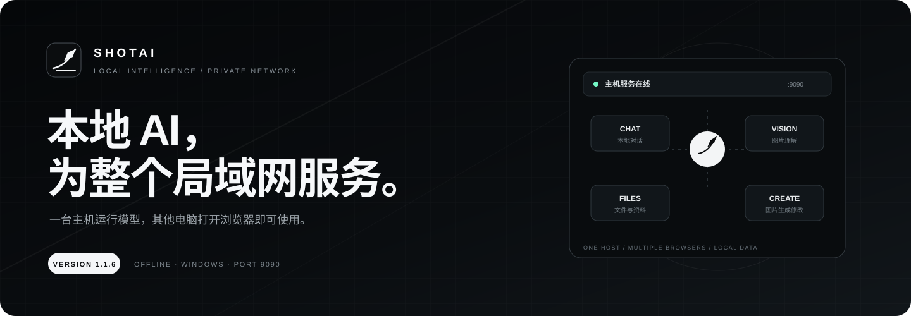
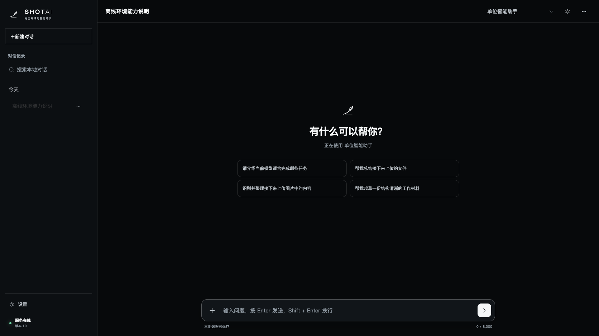
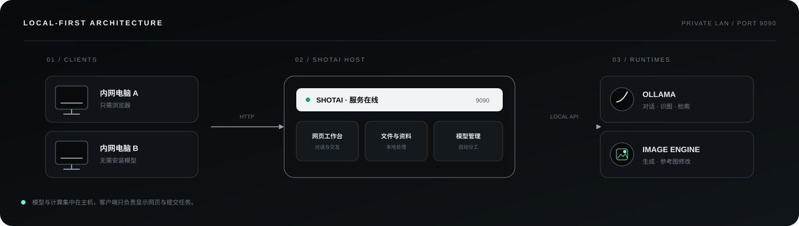

  

<h1 align="center">ShotAI · 局域网本地 AI 工作台</h1>

  <strong>在一台主机运行本地模型，让局域网设备通过浏览器共同使用。</strong>

  
  
  
  

  <a href="https://github.com/ReDChicagOTypewriteR/ShotAI/releases">版本与下载</a> ·
  <a href="docs/INSTALLATION.md">安装部署</a> ·
  <a href="docs/SUPPORTED_MODELS.md">支持的模型</a> ·
  <a href="docs/UPDATES.md">版本进度</a> ·
  <a href="docs/FAQ.md">常见问答</a>

  

## 项目简介

ShotAI 将本地大模型、文件问答、资料库、图片理解、图片创作和主机监控集中到一个桌面应用中。管理员在 Windows 或 Ubuntu 主机上安装并准备模型后，局域网内的其他使用者只需打开浏览器，无需分别安装模型运行环境。

ShotAI 负责界面、模型管理、任务路由、文件处理和局域网共享；Ollama 与本地图片运行组件负责实际推理。模型权重不会随安装包提供。

## 主要能力

| 能力 | 说明 |
| --- | --- |
| 本地对话 | 流式回答、停止、重答、编辑问题和多会话管理 |
| 中英文界面 | 设置中切换中文或 English；首次跟随系统语言，非中文环境回退英文 |
| 文件与资料库 | 聊天中分析文件、生成或修改 Excel / Word / PDF，并支持资料检索 |
| 图片理解 | 使用视觉模型分析图片、截图和文档页面 |
| 图片生成与修改 | 在对话中直接描述生成要求，并可继续修改上一张图片 |
| 模型管理 | 导入、体检、实际加载检测、诊断与完整清理 |
| 局域网共享 | 主机提供统一的 `9090` 入口，其他设备通过浏览器使用 |
| 主机监控 | 查看在线数量、任务队列、CPU、内存、磁盘和 GPU 状态 |

## 快速开始

安装对应平台的软件包，在主机导入模型，然后通过 `http://主机IPv4地址:9090` 在可信局域网中使用。安装包不包含模型权重或 NVIDIA 驱动；图片生成需要同平台可选运行扩展。

详细步骤见[安装与部署指南](docs/INSTALLATION.md)。

## 技术栈与兼容

公共界面使用 Vue 与 TypeScript，桌面客户端使用 Electron，局域网服务使用 Node.js。支持 Windows 10/11 x86_64 与 Ubuntu 22.04 x86_64。

ShotAI 通过运行组件支持多个开放模型厂商，不绑定单一模型系列。具体兼容范围取决于模型文件格式、Ollama 或图片运行组件版本以及设备资源。

- 对话模型：Qwen、DeepSeek、Llama、Gemma、Mistral、Phi、Yi 等；
- 图片理解：Qwen-VL、Llama Vision、MiniCPM-V、LLaVA 等兼容版本；
- 资料检索：Qwen Embedding、BGE、Nomic Embed 等；
- 图片生成：FLUX、Stable Diffusion、SDXL、SD3 和兼容微调模型。

详见[支持的模型与厂商](docs/SUPPORTED_MODELS.md)。

## 下载与版本

**1.3.0 为待实机验证的预发布**：整合办公文件能力，优化模型导入、诊断、完整清理、并发与操作反馈，移除宠物，精简运行组件。简短说明见[1.3.0 更新内容](docs/RELEASE-1.3.0.md)。

安装包与可选扩展发布到 [GitHub Releases](https://github.com/ReDChicagOTypewriteR/ShotAI/releases)。1.3.0 的核心安装包内置各平台 Ollama CUDA 12，不包含图片运行组件和模型权重。

| 平台 / 方式 | 1.3.0 下载 |
| --- | --- |
| Windows x86_64 | [EXE 安装包](https://github.com/ReDChicagOTypewriteR/ShotAI/releases/download/v1.3.0/ShotAI-1.3.0-Windows-x64-Ollama-CUDA12-Setup.exe) |
| Ubuntu 22.04 x86_64 | [DEB](https://github.com/ReDChicagOTypewriteR/ShotAI/releases/download/v1.3.0/ShotAI-1.3.0-Ubuntu-22.04-x86_64-Ollama-CUDA12.deb) · [AppImage](https://github.com/ReDChicagOTypewriteR/ShotAI/releases/download/v1.3.0/ShotAI-1.3.0-Ubuntu-22.04-x86_64-Ollama-CUDA12.AppImage) |
| 图片运行扩展与校验文件 | [预发布资源](https://github.com/ReDChicagOTypewriteR/ShotAI/releases/tag/v1.3.0) |

## 项目结构

| 路径 | 用途 |
| --- | --- |
| `src/` | 公共界面与文件处理 |
| `scripts/` | 局域网服务、调度、诊断与测试 |
| `desktop/electron/` | 双平台客户端与安装配置 |
| `docs/` | 模型、安装、问答和版本说明 |

## 文档与支持

- [从 v1.1.6 至今的 Windows / Ubuntu 更新进度](docs/UPDATES.md)
- [常见问题与排查](docs/FAQ.md)
- [安装与部署指南](docs/INSTALLATION.md)
- [支持的模型与厂商](docs/SUPPORTED_MODELS.md)
- [GitHub Releases](https://github.com/ReDChicagOTypewriteR/ShotAI/releases)

## 许可与注意事项

ShotAI 适合可信局域网环境。请勿将 `9090`、Ollama 或图片运行组件端口直接暴露到公网。项目许可见 [LICENSE](LICENSE)，模型及第三方运行组件分别遵循各自许可证。
